<picture>
  <source media="(prefers-color-scheme: dark)" srcset="assets/hero-dark.svg">
  
</picture>

I work on AI platforms: agent runtimes, LLM gateways, authorization, sandboxed execution, and the Kubernetes and on-prem infrastructure they run on. I learn the most from the places where application code meets framework internals — async execution, queues, memory behavior, connection pooling — and from production failures I didn't see coming.

<picture>
  <source media="(prefers-color-scheme: dark)" srcset="assets/architecture-dark.svg">
  
</picture>

<picture>
  <source media="(prefers-color-scheme: dark)" srcset="assets/metrics-dark.svg">
  
</picture>

Some of the problems I've been working through on this project:

- **Relationship-based access control.** Domain facts stay in PostgreSQL and are projected into a ReBAC graph by a background worker. Checks fail closed until a membership change has been applied, so users read their own writes without every check paying for full consistency.
- **Recording every change.** Mutations run as typed transactions or recoverable sagas, with idempotency keys, before/after snapshots, an append-only audit log, and revert plans that stop when the current state has drifted.
- **Letting tooling catch mistakes.** Repository checks cover per-handler authorization policy, database access ownership, bounded request I/O, and migration safety. I try to treat a fix as done only after the affected path has actually run.

 

<picture>
  <source media="(prefers-color-scheme: dark)" srcset="assets/impact-dark.svg">
  
</picture>

At MaiAgent I worked on the migration from LlamaIndex to LangChain/LangGraph, an OpenAI-compatible LLM gateway, and a fair amount of production debugging across CPython, aiohttp, Django ASGI, PgBouncer, and Celery — with a lot of help from a great team.

### Open source

<a href="https://github.com/zxzinn/django-makemessages-rs"><picture><source media="(prefers-color-scheme: dark)" srcset="assets/card-django-makemessages-rs-dark.svg"></picture></a><a href="https://github.com/zxzinn/cf-gdrive-mcp"><picture><source media="(prefers-color-scheme: dark)" srcset="assets/card-cf-gdrive-mcp-dark.svg"></picture></a>
<a href="https://github.com/zxzinn/opencti-mcp"><picture><source media="(prefers-color-scheme: dark)" srcset="assets/card-opencti-mcp-dark.svg"></picture></a><a href="https://github.com/zxzinn/neon-selfhost"><picture><source media="(prefers-color-scheme: dark)" srcset="assets/card-neon-selfhost-dark.svg"></picture></a>
<a href="https://github.com/zxzinn/django-channels-jwt-stateless"><picture><source media="(prefers-color-scheme: dark)" srcset="assets/card-django-channels-jwt-stateless-dark.svg"></picture></a><a href="https://github.com/zxzinn/djangorestframework-camel-case"><picture><source media="(prefers-color-scheme: dark)" srcset="assets/card-djangorestframework-camel-case-dark.svg"></picture></a>

 

<a href="https://github.com/search?q=author%3Azxzinn+is%3Apr+is%3Amerged+-user%3Azxzinn&type=pullrequests"><picture><source media="(prefers-color-scheme: dark)" srcset="assets/upstream-dark.svg"></picture></a>

  <a href="https://github.com/run-llama/llama_index/pulls?q=is%3Apr+author%3Azxzinn+is%3Amerged">LlamaIndex PRs</a> ·
  <a href="https://github.com/lightpanda-io/browser/pull/4080">Lightpanda #4080</a> ·
  <a href="https://github.com/open-telemetry/opentelemetry-js/pull/6215">OpenTelemetry JS #6215</a> ·
  <a href="https://github.com/vercel/ai-elements/pull/125">AI Elements #125</a> ·
  <a href="https://github.com/neoforged/NeoForge/pull/3260">NeoForge #3260</a>

<!-- private-stats:start -->
Private monorepo counters updated 2026-11-09 (UTC). Counts cover authored merged PRs and all issues since repository creation, workspace package/app manifests, numbered ADRs, and paired bilingual documents under docs/ (excluding README indexes).
<!-- private-stats:end -->

<!-- public-stats:start -->
Public GitHub counters updated 2026-11-08 (UTC).
<!-- public-stats:end -->

---

  <a href="https://www.linkedin.com/in/zxzinn/">LinkedIn</a> ·
  <a href="mailto:zhaoxinzhang0429@gmail.com">Email</a>

